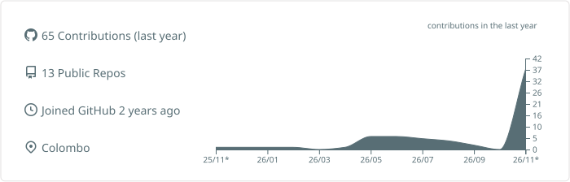

<picture>
  <source media="(prefers-color-scheme: dark)" srcset="./assets/animated-name-dark.svg" />
  <source media="(prefers-color-scheme: light)" srcset="./assets/animated-name-light.svg" />
  
</picture>

  <strong>Full-Stack Developer · Colombo, Sri Lanka</strong> 
  Building purposeful software with thoughtful interfaces, dependable APIs, and practical AI.

  

  
  &nbsp;
  
  &nbsp;
  
    
  

  
  
  

  

## A little more about me

<table>
  <tr>
    <td width="50%" valign="top">
<strong>01 / What I'm building</strong>

Full-stack applications that connect clear interfaces with reliable backend services to solve Business problems.
</td>
    <td width="50%" valign="top">
<strong>02 / What I'm exploring</strong>

AI integration, retrieval-augmented generation, and practical ways to bring intelligent features into useful software.
</td>
  </tr>
  <tr>
    <td width="50%" valign="top">
<strong>03 / Let's collaborate</strong>

Full-stack products, open-source projects, and Business digital transformation ideas.
</td>
    <td width="50%" valign="top">
<strong>04 / Ask me about</strong>

React, TypeScript, Node.js, REST APIs, databases, Building RAG pipelines, Training image classification models and connecting AI models to real applications.
</td>
  </tr>
</table>

## Technology toolbox

<table>
  <tr><th align="left">AREA</th><th align="left">STACK &amp; TOOLS</th></tr>
  <tr>
    <td width="25%"><code>01</code> <strong>Programming Languages</strong></td>
    <td>
<picture>
  <source media="(prefers-color-scheme: dark)" srcset="https://skillicons.dev/icons?i=ts&amp;theme=dark" />
  <source media="(prefers-color-scheme: light)" srcset="https://skillicons.dev/icons?i=ts&amp;theme=light" />
  
</picture>
<picture>
  <source media="(prefers-color-scheme: dark)" srcset="https://skillicons.dev/icons?i=js&amp;theme=dark" />
  <source media="(prefers-color-scheme: light)" srcset="https://skillicons.dev/icons?i=js&amp;theme=light" />
  
</picture>
<picture>
  <source media="(prefers-color-scheme: dark)" srcset="https://skillicons.dev/icons?i=py&amp;theme=dark" />
  <source media="(prefers-color-scheme: light)" srcset="https://skillicons.dev/icons?i=py&amp;theme=light" />
  
</picture>
<picture>
  <source media="(prefers-color-scheme: dark)" srcset="https://skillicons.dev/icons?i=cs&amp;theme=dark" />
  <source media="(prefers-color-scheme: light)" srcset="https://skillicons.dev/icons?i=cs&amp;theme=light" />
  
</picture>
 TypeScript · JavaScript · Python · C#
    </td>
  </tr>
  <tr>
    <td width="25%"><code>02</code> <strong>Frontend Development</strong></td>
    <td>
<picture>
  <source media="(prefers-color-scheme: dark)" srcset="https://skillicons.dev/icons?i=react&amp;theme=dark" />
  <source media="(prefers-color-scheme: light)" srcset="https://skillicons.dev/icons?i=react&amp;theme=light" />
  
</picture>
<picture>
  <source media="(prefers-color-scheme: dark)" srcset="https://skillicons.dev/icons?i=nextjs&amp;theme=dark" />
  <source media="(prefers-color-scheme: light)" srcset="https://skillicons.dev/icons?i=nextjs&amp;theme=light" />
  
</picture>
<picture>
  <source media="(prefers-color-scheme: dark)" srcset="https://skillicons.dev/icons?i=tailwind&amp;theme=dark" />
  <source media="(prefers-color-scheme: light)" srcset="https://skillicons.dev/icons?i=tailwind&amp;theme=light" />
  
</picture>
<picture>
  <source media="(prefers-color-scheme: dark)" srcset="https://skillicons.dev/icons?i=html&amp;theme=dark" />
  <source media="(prefers-color-scheme: light)" srcset="https://skillicons.dev/icons?i=html&amp;theme=light" />
  
</picture>
<picture>
  <source media="(prefers-color-scheme: dark)" srcset="https://skillicons.dev/icons?i=css&amp;theme=dark" />
  <source media="(prefers-color-scheme: light)" srcset="https://skillicons.dev/icons?i=css&amp;theme=light" />
  
</picture>
 React · Next.js · Tailwind CSS · HTML5 · CSS3
    </td>
  </tr>
  <tr>
    <td width="25%"><code>03</code> <strong>Backend &amp; APIs</strong></td>
    <td>
<picture>
  <source media="(prefers-color-scheme: dark)" srcset="https://skillicons.dev/icons?i=nodejs&amp;theme=dark" />
  <source media="(prefers-color-scheme: light)" srcset="https://skillicons.dev/icons?i=nodejs&amp;theme=light" />
  
</picture>
<picture>
  <source media="(prefers-color-scheme: dark)" srcset="https://skillicons.dev/icons?i=express&amp;theme=dark" />
  <source media="(prefers-color-scheme: light)" srcset="https://skillicons.dev/icons?i=express&amp;theme=light" />
  
</picture>
<picture>
  <source media="(prefers-color-scheme: dark)" srcset="https://skillicons.dev/icons?i=dotnet&amp;theme=dark" />
  <source media="(prefers-color-scheme: light)" srcset="https://skillicons.dev/icons?i=dotnet&amp;theme=light" />
  
</picture>

 

 Node.js · Express.js · .NET · Socket.IO · REST APIs
    </td>
  </tr>
  <tr>
    <td width="25%"><code>04</code> <strong>Databases &amp; Backend Platforms</strong></td>
    <td>
<picture>
  <source media="(prefers-color-scheme: dark)" srcset="https://skillicons.dev/icons?i=postgres&amp;theme=dark" />
  <source media="(prefers-color-scheme: light)" srcset="https://skillicons.dev/icons?i=postgres&amp;theme=light" />
  
</picture>
<picture>
  <source media="(prefers-color-scheme: dark)" srcset="https://skillicons.dev/icons?i=supabase&amp;theme=dark" />
  <source media="(prefers-color-scheme: light)" srcset="https://skillicons.dev/icons?i=supabase&amp;theme=light" />
  
</picture>
<picture>
  <source media="(prefers-color-scheme: dark)" srcset="https://skillicons.dev/icons?i=mongodb&amp;theme=dark" />
  <source media="(prefers-color-scheme: light)" srcset="https://skillicons.dev/icons?i=mongodb&amp;theme=light" />
  
</picture>

 PostgreSQL · Supabase · MongoDB · Neo4j
    </td>
  </tr>
  <tr>
    <td width="25%"><code>05</code> <strong>Development Tools &amp; Testing</strong></td>
    <td>
<picture>
  <source media="(prefers-color-scheme: dark)" srcset="https://skillicons.dev/icons?i=git&amp;theme=dark" />
  <source media="(prefers-color-scheme: light)" srcset="https://skillicons.dev/icons?i=git&amp;theme=light" />
  
</picture>
<picture>
  <source media="(prefers-color-scheme: dark)" srcset="https://skillicons.dev/icons?i=github&amp;theme=dark" />
  <source media="(prefers-color-scheme: light)" srcset="https://skillicons.dev/icons?i=github&amp;theme=light" />
  
</picture>
<picture>
  <source media="(prefers-color-scheme: dark)" srcset="https://skillicons.dev/icons?i=jest&amp;theme=dark" />
  <source media="(prefers-color-scheme: light)" srcset="https://skillicons.dev/icons?i=jest&amp;theme=light" />
  
</picture>
<picture>
  <source media="(prefers-color-scheme: dark)" srcset="https://skillicons.dev/icons?i=linux&amp;theme=dark" />
  <source media="(prefers-color-scheme: light)" srcset="https://skillicons.dev/icons?i=linux&amp;theme=light" />
  
</picture>
<picture>
  <source media="(prefers-color-scheme: dark)" srcset="https://skillicons.dev/icons?i=figma&amp;theme=dark" />
  <source media="(prefers-color-scheme: light)" srcset="https://skillicons.dev/icons?i=figma&amp;theme=light" />
  
</picture>
<picture>
  <source media="(prefers-color-scheme: dark)" srcset="https://skillicons.dev/icons?i=vscode&amp;theme=dark" />
  <source media="(prefers-color-scheme: light)" srcset="https://skillicons.dev/icons?i=vscode&amp;theme=light" />
  
</picture>
 Git · GitHub · Jest · Linux · Figma · VS Code
    </td>
  </tr>
</table>

## Developer analytics

<picture>
  <source media="(prefers-color-scheme: dark)" srcset="./assets/profile-details-dark-v2.svg" />
  <source media="(prefers-color-scheme: light)" srcset="./assets/profile-details-light-v2.svg" />
  
</picture>
<picture>
  <source media="(prefers-color-scheme: dark)" srcset="./assets/stats-dark.svg" />
  <source media="(prefers-color-scheme: light)" srcset="./assets/stats-light.svg" />
  
</picture>
<picture>
  <source media="(prefers-color-scheme: dark)" srcset="https://github-readme-stats.vercel.app/api/top-langs?username=pathum-sb&amp;layout=donut&amp;langs_count=5&amp;card_width=300&amp;custom_title=Language%20Breakdown&amp;hide_border=true&amp;disable_animations=true&amp;size_weight=0.5&amp;count_weight=0.5&amp;bg_color=09142E&amp;title_color=3B82F6&amp;text_color=FFFFFF" />
  <source media="(prefers-color-scheme: light)" srcset="https://github-readme-stats.vercel.app/api/top-langs?username=pathum-sb&amp;layout=donut&amp;langs_count=5&amp;card_width=300&amp;custom_title=Language%20Breakdown&amp;hide_border=true&amp;disable_animations=true&amp;size_weight=0.5&amp;count_weight=0.5&amp;bg_color=FFFFFF&amp;title_color=0066FF&amp;text_color=0B1F4B" />
  
</picture>

<picture>
  <source media="(prefers-color-scheme: dark)" srcset="https://streak-stats.demolab.com?user=pathum-sb&amp;hide_border=true&amp;disable_animations=true&amp;ring=0066FF&amp;fire=0066FF&amp;currStreakLabel=0066FF&amp;background=09142E&amp;currStreakNum=FFFFFF&amp;sideNums=FFFFFF&amp;sideLabels=FFFFFF&amp;dates=94A3B8" />
  <source media="(prefers-color-scheme: light)" srcset="https://streak-stats.demolab.com?user=pathum-sb&amp;hide_border=true&amp;disable_animations=true&amp;ring=0066FF&amp;fire=0066FF&amp;currStreakLabel=0066FF&amp;background=FFFFFF&amp;currStreakNum=0B1F4B&amp;sideNums=0B1F4B&amp;sideLabels=0B1F4B&amp;dates=475569" />
  
</picture>

  
How to read this dashboard

  The overview shows contribution activity, the statistics summarize public GitHub work, and the language card shows a percentage breakdown calculated from public repositories. These are activity snapshots, not measures of proficiency. The streak card tracks consecutive days with qualifying contributions. Third-party cards may be cached or temporarily unavailable.

  [Explore the repositories behind the numbers →](https://github.com/pathum-sb?tab=repositories)

## Contribution journey

Small steps, steady progress. Keep building.

  

---

  <strong>BUILD WITH PURPOSE · SOLVE REAL PROBLEMS · KEEP LEARNING</strong>  
  Have an idea worth building? <a href="mailto:pathumsanjaya.me@gmail.com">Let's connect.</a>

