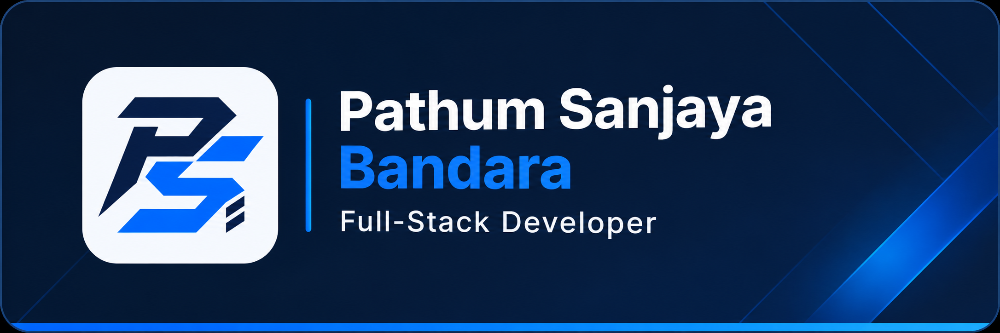

<picture>
  <source media="(prefers-color-scheme: dark)" srcset="./assets/animated-name-dark.svg" />
  <source media="(prefers-color-scheme: light)" srcset="./assets/animated-name-light.svg" />
  
</picture>

  <strong>Full-Stack Developer · Colombo, Sri Lanka</strong> 
  Building purposeful software with thoughtful interfaces, dependable APIs, and practical AI.

  

  
  &nbsp;
  
  &nbsp;
  
    
  

  
  
  

  

## A little more about me

<table>
  <tr>
    <td width="50%" valign="top"><h3>01 / What I'm building</h3>
Full-stack applications that connect clear interfaces with reliable backend services to solve everyday problems.
</td>
    <td width="50%" valign="top"><h3>02 / What I'm exploring</h3>
Applied AI, retrieval-augmented generation, and practical ways to bring intelligent features into useful software.
</td>
  </tr>
  <tr>
    <td width="50%" valign="top"><h3>03 / Let's collaborate</h3>
Full-stack products, open-source projects, and applied AI ideas. Open to software engineering internships.
</td>
    <td width="50%" valign="top"><h3>04 / Ask me about</h3>
React, TypeScript, Node.js, REST APIs, databases, and connecting AI models to real applications.
</td>
  </tr>
</table>

## Technology toolbox

<table>
  <tr><th align="left">AREA</th><th align="left">STACK &amp; TOOLS</th></tr>
  <tr>
    <td width="25%"><code>01</code> <strong>Programming Languages</strong></td>
    <td>
<picture>
  <source media="(prefers-color-scheme: dark)" srcset="https://skillicons.dev/icons?i=ts&amp;theme=dark" />
  <source media="(prefers-color-scheme: light)" srcset="https://skillicons.dev/icons?i=ts&amp;theme=light" />
  
</picture>
<picture>
  <source media="(prefers-color-scheme: dark)" srcset="https://skillicons.dev/icons?i=js&amp;theme=dark" />
  <source media="(prefers-color-scheme: light)" srcset="https://skillicons.dev/icons?i=js&amp;theme=light" />
  
</picture>
<picture>
  <source media="(prefers-color-scheme: dark)" srcset="https://skillicons.dev/icons?i=py&amp;theme=dark" />
  <source media="(prefers-color-scheme: light)" srcset="https://skillicons.dev/icons?i=py&amp;theme=light" />
  
</picture>
<picture>
  <source media="(prefers-color-scheme: dark)" srcset="https://skillicons.dev/icons?i=cs&amp;theme=dark" />
  <source media="(prefers-color-scheme: light)" srcset="https://skillicons.dev/icons?i=cs&amp;theme=light" />
  
</picture>
 TypeScript · JavaScript · Python · C#
    </td>
  </tr>
  <tr>
    <td width="25%"><code>02</code> <strong>Frontend Development</strong></td>
    <td>
<picture>
  <source media="(prefers-color-scheme: dark)" srcset="https://skillicons.dev/icons?i=react&amp;theme=dark" />
  <source media="(prefers-color-scheme: light)" srcset="https://skillicons.dev/icons?i=react&amp;theme=light" />
  
</picture>
<picture>
  <source media="(prefers-color-scheme: dark)" srcset="https://skillicons.dev/icons?i=nextjs&amp;theme=dark" />
  <source media="(prefers-color-scheme: light)" srcset="https://skillicons.dev/icons?i=nextjs&amp;theme=light" />
  
</picture>
<picture>
  <source media="(prefers-color-scheme: dark)" srcset="https://skillicons.dev/icons?i=tailwind&amp;theme=dark" />
  <source media="(prefers-color-scheme: light)" srcset="https://skillicons.dev/icons?i=tailwind&amp;theme=light" />
  
</picture>
<picture>
  <source media="(prefers-color-scheme: dark)" srcset="https://skillicons.dev/icons?i=html&amp;theme=dark" />
  <source media="(prefers-color-scheme: light)" srcset="https://skillicons.dev/icons?i=html&amp;theme=light" />
  
</picture>
<picture>
  <source media="(prefers-color-scheme: dark)" srcset="https://skillicons.dev/icons?i=css&amp;theme=dark" />
  <source media="(prefers-color-scheme: light)" srcset="https://skillicons.dev/icons?i=css&amp;theme=light" />
  
</picture>
 React · Next.js · Tailwind CSS · HTML5 · CSS3
    </td>
  </tr>
  <tr>
    <td width="25%"><code>03</code> <strong>Backend &amp; APIs</strong></td>
    <td>
<picture>
  <source media="(prefers-color-scheme: dark)" srcset="https://skillicons.dev/icons?i=nodejs&amp;theme=dark" />
  <source media="(prefers-color-scheme: light)" srcset="https://skillicons.dev/icons?i=nodejs&amp;theme=light" />
  
</picture>
<picture>
  <source media="(prefers-color-scheme: dark)" srcset="https://skillicons.dev/icons?i=express&amp;theme=dark" />
  <source media="(prefers-color-scheme: light)" srcset="https://skillicons.dev/icons?i=express&amp;theme=light" />
  
</picture>
<picture>
  <source media="(prefers-color-scheme: dark)" srcset="https://skillicons.dev/icons?i=dotnet&amp;theme=dark" />
  <source media="(prefers-color-scheme: light)" srcset="https://skillicons.dev/icons?i=dotnet&amp;theme=light" />
  
</picture>

 

 Node.js · Express.js · .NET · Socket.IO · REST APIs
    </td>
  </tr>
  <tr>
    <td width="25%"><code>04</code> <strong>Databases &amp; Backend Platforms</strong></td>
    <td>
<picture>
  <source media="(prefers-color-scheme: dark)" srcset="https://skillicons.dev/icons?i=postgres&amp;theme=dark" />
  <source media="(prefers-color-scheme: light)" srcset="https://skillicons.dev/icons?i=postgres&amp;theme=light" />
  
</picture>
<picture>
  <source media="(prefers-color-scheme: dark)" srcset="https://skillicons.dev/icons?i=supabase&amp;theme=dark" />
  <source media="(prefers-color-scheme: light)" srcset="https://skillicons.dev/icons?i=supabase&amp;theme=light" />
  
</picture>
<picture>
  <source media="(prefers-color-scheme: dark)" srcset="https://skillicons.dev/icons?i=mongodb&amp;theme=dark" />
  <source media="(prefers-color-scheme: light)" srcset="https://skillicons.dev/icons?i=mongodb&amp;theme=light" />
  
</picture>

 

 PostgreSQL · Supabase · MongoDB · Neo4j · pgvector · Convex
    </td>
  </tr>
  <tr>
    <td width="25%"><code>05</code> <strong>AI &amp; LLM Integration</strong></td>
    <td>

 

 Gemini · RAG · Groq · Azure Custom Vision
    </td>
  </tr>
  <tr>
    <td width="25%"><code>06</code> <strong>Development Tools &amp; Testing</strong></td>
    <td>
<picture>
  <source media="(prefers-color-scheme: dark)" srcset="https://skillicons.dev/icons?i=git&amp;theme=dark" />
  <source media="(prefers-color-scheme: light)" srcset="https://skillicons.dev/icons?i=git&amp;theme=light" />
  
</picture>
<picture>
  <source media="(prefers-color-scheme: dark)" srcset="https://skillicons.dev/icons?i=github&amp;theme=dark" />
  <source media="(prefers-color-scheme: light)" srcset="https://skillicons.dev/icons?i=github&amp;theme=light" />
  
</picture>
<picture>
  <source media="(prefers-color-scheme: dark)" srcset="https://skillicons.dev/icons?i=jest&amp;theme=dark" />
  <source media="(prefers-color-scheme: light)" srcset="https://skillicons.dev/icons?i=jest&amp;theme=light" />
  
</picture>
<picture>
  <source media="(prefers-color-scheme: dark)" srcset="https://skillicons.dev/icons?i=linux&amp;theme=dark" />
  <source media="(prefers-color-scheme: light)" srcset="https://skillicons.dev/icons?i=linux&amp;theme=light" />
  
</picture>
<picture>
  <source media="(prefers-color-scheme: dark)" srcset="https://skillicons.dev/icons?i=figma&amp;theme=dark" />
  <source media="(prefers-color-scheme: light)" srcset="https://skillicons.dev/icons?i=figma&amp;theme=light" />
  
</picture>
<picture>
  <source media="(prefers-color-scheme: dark)" srcset="https://skillicons.dev/icons?i=vscode&amp;theme=dark" />
  <source media="(prefers-color-scheme: light)" srcset="https://skillicons.dev/icons?i=vscode&amp;theme=light" />
  
</picture>
 

 Git · GitHub · Jest · Linux · Figma · VS Code · Supertest
    </td>
  </tr>
</table>

## Developer analytics

<picture>
  <source media="(prefers-color-scheme: dark)" srcset="https://github-profile-summary-cards.vercel.app/api/cards/profile-details?username=pathum-sb&amp;theme=tokyonight" />
  <source media="(prefers-color-scheme: light)" srcset="https://github-profile-summary-cards.vercel.app/api/cards/profile-details?username=pathum-sb&amp;theme=default" />
  
</picture>
<picture>
  <source media="(prefers-color-scheme: dark)" srcset="https://github-profile-summary-cards.vercel.app/api/cards/stats?username=pathum-sb&amp;theme=tokyonight" />
  <source media="(prefers-color-scheme: light)" srcset="https://github-profile-summary-cards.vercel.app/api/cards/stats?username=pathum-sb&amp;theme=default" />
  
</picture>
<picture>
  <source media="(prefers-color-scheme: dark)" srcset="https://github-profile-summary-cards.vercel.app/api/cards/repos-per-language?username=pathum-sb&amp;theme=tokyonight" />
  <source media="(prefers-color-scheme: light)" srcset="https://github-profile-summary-cards.vercel.app/api/cards/repos-per-language?username=pathum-sb&amp;theme=default" />
  
</picture>

<picture>
  <source media="(prefers-color-scheme: dark)" srcset="https://streak-stats.demolab.com?user=pathum-sb&amp;hide_border=true&amp;disable_animations=true&amp;ring=0066FF&amp;fire=0066FF&amp;currStreakLabel=0066FF&amp;background=09142E&amp;currStreakNum=FFFFFF&amp;sideNums=FFFFFF&amp;sideLabels=FFFFFF&amp;dates=94A3B8" />
  <source media="(prefers-color-scheme: light)" srcset="https://streak-stats.demolab.com?user=pathum-sb&amp;hide_border=true&amp;disable_animations=true&amp;ring=0066FF&amp;fire=0066FF&amp;currStreakLabel=0066FF&amp;background=FFFFFF&amp;currStreakNum=0B1F4B&amp;sideNums=0B1F4B&amp;sideLabels=0B1F4B&amp;dates=475569" />
  
</picture>

  
How to read this dashboard

  The overview shows contribution activity, the statistics summarize public GitHub work, and the language card groups repositories by their primary language. These are activity snapshots, not measures of proficiency. The streak card tracks consecutive days with qualifying contributions. Third-party cards may be cached or temporarily unavailable.

  [Explore the repositories behind the numbers →](https://github.com/pathum-sb?tab=repositories)

## Contribution journey

Small steps, steady progress. Keep building.

  

---

  <strong>BUILD WITH PURPOSE · SOLVE REAL PROBLEMS · KEEP LEARNING</strong>  
  Have an idea worth building? <a href="mailto:pathumsanjaya.me@gmail.com">Let's connect.</a>

